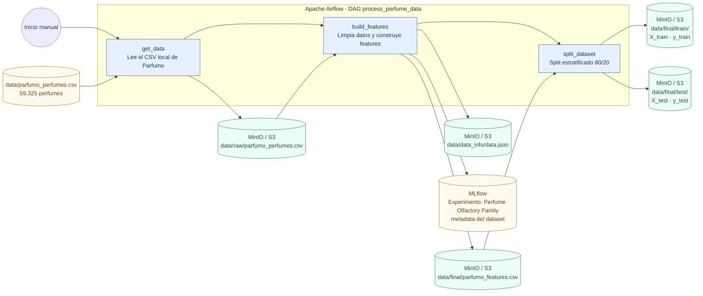
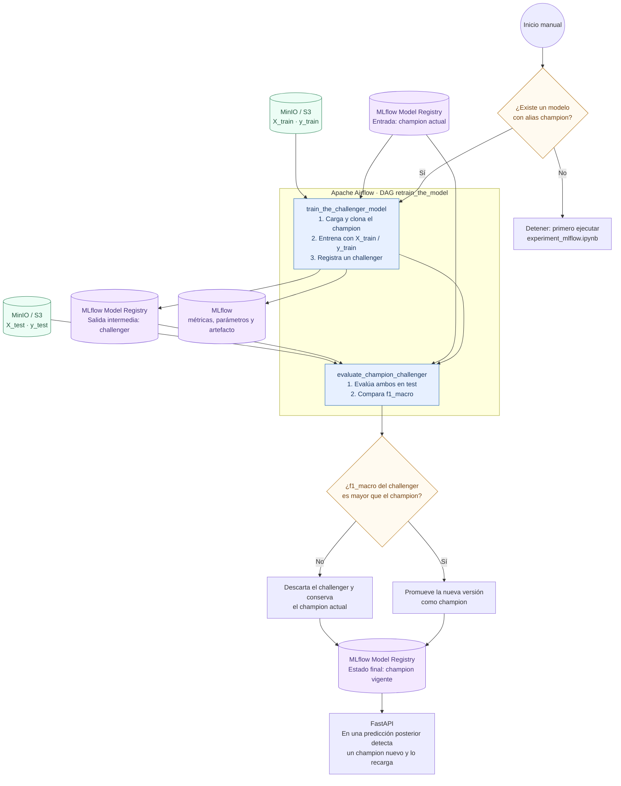

# Clasificador de Familia Olfativa en Perfumes — TP de Operaciones de Aprendizaje Automático

### CEIA - FIUBA

Este repo productiviza, en el ambiente de **ML Models and something more Inc.** (Docker + Apache
Airflow + MLflow + PostgreSQL + MinIO + FastAPI), el modelo desarrollado en el TP final de
**Aprendizaje de Máquina I**: *"Clasificación de familia olfativa en perfumes a partir de su
composición de notas"*.

El modelo predice la **familia olfativa dominante** de un perfume (una de 20 clases: `Floral`,
`Woody`, `Spicy`, `Fresh`, etc.) a partir de su composición de notas (salida/corazón/fondo) y
metadata básica (año, concentración), usando el catálogo público de
[Parfumo](https://www.parfumo.com/) (59.325 perfumes).
La idea de fondo, documentada ya en el TP de AMq1, es que un clasificador así puede
usarse para etiquetar automáticamente fórmulas nuevas sin depender de un experto humano.

> **Alcance de este TP.** Lo que se productiviza acá es el clasificador notas → familia olfativa,
> nada más..

## Arquitectura

Igual que el ambiente base de la cátedra: Apache Airflow (orquestación), MLflow (tracking +
registro de modelos), PostgreSQL (bases de Airflow y MLflow), MinIO (Data Lake simulando S3),
Jupyter (experimentación) y FastAPI (servicio de predicciones). Ver `docker-compose.yaml`.

**Todo corre en contenedores, incluido el notebook de experimentación.** A diferencia del ejemplo
base de la cátedra (donde el notebook se corre localmente con Jupyter instalado a mano, apuntando a
`localhost`), acá se agregó un servicio `jupyter` propio (`dockerfiles/jupyter/`) para que
cualquiera del grupo pueda levantar el stack y correr exactamente lo mismo sin instalar nada en su
máquina ni depender de su propio setup de Python.

Lo que se agregó/adaptó respecto al ejemplo de Heart Disease de la cátedra:

| Pieza | Qué hace |
|---|---|
| `data/parfumo_perfumes.csv` | Catálogo crudo de Parfumo (59.325 filas), versionado en el repo. Se monta de solo lectura en los contenedores de Airflow (`docker-compose.yaml`). |
| `src/perfume_features.py` | Limpieza + feature engineering de referencia (documentada), reutilizada por el notebook de entrenamiento. |
| `airflow/dags/etl_process.py` | DAG `process_perfume_data`: sube el CSV a `s3://data`, limpia y arma las 256 features (240 notas multi-hot + 6 numéricas + dummies de concentración), y hace el split train/test. |
| `airflow/dags/retrain_the_model.py` | DAG `retrain_the_model`: reentrena un challenger, lo compara contra el campeón por `f1_macro`, y promueve al mejor. |
| `dockerfiles/jupyter/` | Servicio de Jupyter propio (no está en el ejemplo base), con Optuna/MLflow/awswrangler preinstalados, conectado a la red de Docker del proyecto. |
| `notebook_example/experiment_mlflow.ipynb` | Búsqueda de hiperparámetros con Optuna sobre los mismos 5 algoritmos del TP de AMq1 (KNN, Árbol, Random Forest, Gradient Boosting, SVM), trackeada en MLflow, con registro del primer campeón. Corre dentro del contenedor de Jupyter. |
| `dockerfiles/fastapi/app.py` | Endpoint `/predict/`: recibe notas + metadata, devuelve la familia olfativa predicha (y, si el modelo lo soporta, las 3 familias con mayor probabilidad). |

### Flujo del DAG de ETL

El DAG `process_perfume_data` publica el dataset crudo en el Data Lake, construye las
features y genera los conjuntos de entrenamiento y test que usan el notebook y el DAG
de reentrenamiento.



### Flujo del DAG de reentrenamiento

El DAG `retrain_the_model` parte del modelo con alias `champion`, entrena un modelo
`challenger` sobre el conjunto de entrenamiento y lo promueve solamente si logra un
`f1_macro` mayor sobre el conjunto de test. La API detecta en una predicción posterior
que cambió el campeón y recarga el modelo sin reiniciar el contenedor.



## Por qué el target es lo que es

`dominant_accord` es la primera familia de la lista `Main_Accords` que declara Parfumo para cada
perfume (Parfumo las ordena de mayor a menor intensidad percibida). Es una simplificación: un
perfume real suele tener 4-5 familias a la vez, no una sola. Al igual que en la sección de limitaciones del TP
de AMq1 para el detalle, se documenta ahí como un próximo paso natural (clasificación
multi-etiqueta) que no se aborda en esta primera versión productiva.

**Nota sobre `n_accords` (limitación conocida):** una de las 6 features numéricas es la cantidad de
familias que Parfumo declara para el perfume. Esa cantidad sale del mismo campo del que sale el
target, así que para un perfume *genuinamente nuevo* (por ejemplo, una fórmula recién generada, sin
ficha de Parfumo) ese dato no existe de antemano. En inferencia se imputa con la mediana de
entrenamiento (ver `src/perfume_features.py`); es una limitación documentada, no un bug.

## Instalación y puesta en marcha (paso a paso)

1. Instalá [Docker Desktop](https://docs.docker.com/desktop/) si todavía no lo tenés.
2. En este repo, en el archivo `.env`, reemplazá `AIRFLOW_UID` por el de tu usuario si estás en
   Mac/Linux (corré `id -u` en la terminal para verlo). Si no, Airflow deja sus carpetas internas
   como root y no vas a poder subir DAGs.
3. Desde la raíz del repo:

   ```bash
   docker compose --profile all up
   ```

   La primera vez va a tardar bastante (build de las imágenes + descarga de las bases). Con
   `docker ps -a` (o Docker Desktop) podés ver cuándo todos los servicios están `healthy`.

4. Una vez arriba:
   - Airflow: http://localhost:8080 (usuario/clave: `airflow` / `airflow`)
   - MLflow: http://localhost:5001
   - MinIO (administración de buckets): http://localhost:9001 (usuario/clave: `minio` / `minio123`)
   - Jupyter (para el notebook de experimentación): http://localhost:8888 — corre adentro de
     Docker, sin token/contraseña (uso local). No hace falta instalar Python/Jupyter/Optuna en tu
     máquina: la idea es que cualquiera del grupo pueda correr exactamente lo mismo, sin depender
     de su propio setup.
   - API: http://localhost:8800/ — documentación interactiva en http://localhost:8800/docs

## Orden para probar el flujo completo

1. En Airflow, activá y corré el DAG **`process_perfume_data`**. Esto sube el dataset a
   `s3://data` y arma la matriz de features + el split train/test.
2. Abrí Jupyter en http://localhost:8888 y corré **`notebook_example/experiment_mlflow.ipynb`**
   (ya viene con las variables de entorno apuntando a los servicios de Docker — `mlflow:5000` y
   `s3:9000` — no a `localhost`, porque el notebook corre dentro de la misma red de contenedores).
   Esto busca el mejor modelo con Optuna y lo registra en MLflow con el alias `champion`.
   **Hace falta correr esto al menos una vez** para tener un campeón real; hasta entonces, la API
   sirve el modelo de fallback empaquetado en `dockerfiles/fastapi/files/`.
3. Probá la API. Ejemplo con `curl`:

   ```bash
   curl -X 'POST' \
     'http://localhost:8800/predict/' \
     -H 'accept: application/json' \
     -H 'Content-Type: application/json' \
     -d '{
     "features": {
       "top_notes": ["Bergamot", "Lemon"],
       "middle_notes": ["Jasmine", "Rose"],
       "base_notes": ["Musk", "Sandalwood", "Vanilla"],
       "release_year": 2026,
       "concentration": "Eau de Parfum"
     }
   }'
   ```

   Respuesta esperada (aproximada, depende del modelo campeón vigente):

   ```json
   {
     "dominant_accord": "Sweet",
     "top_probabilities": {"Sweet": 0.42, "Floral": 0.25, "Citrus": 0.07}
   }
   ```

4. (Opcional) Corré el DAG **`retrain_the_model`** para ver el ciclo challenger vs. campeón. Ojo:
   como no hay perfumes "nuevos" llegando en tiempo real, volver a correr `process_perfume_data`
   antes solo resamplea el mismo catálogo — es esperable que challenger y campeón midan parecido
   (ver nota en el propio DAG).

## Apagar los servicios

```bash
docker compose --profile all down
```

Para además borrar toda la infraestructura (perdiendo lo que haya en los buckets/bases):

```bash
docker compose down --rmi all --volumes
```

## Estado de avance (entrega parcial)

Lo que está implementado y probado en este repo:

- DAG de ETL (`process_perfume_data`), limpieza, feature engineering y split, portado y validado
  contra la misma lógica y los mismos números del TP de AMq1 (21.032 perfumes limpios, 20 clases,
  256 features).
- Experimento de MLflow con búsqueda de hiperparámetros (Optuna) sobre los 5 algoritmos del TP de
  AMq1, con registro de modelo campeón.
- Servicio de FastAPI (`/predict/`) que sirve el modelo campeón (con fallback a un modelo por
  defecto empaquetado en la imagen), usando la misma lógica de features que el entrenamiento.
- DAG de reentrenamiento (`retrain_the_model`) con comparación challenger vs. campeón por
  `f1_macro`.

Lo que falta / próximos pasos:

- Correr el stack completo end-to-end en un entorno limpio (instalación de Docker todavía en
  curso) y confirmar los 5 servicios healthy (Airflow, MLflow, MinIO, Jupyter, FastAPI).
- Correr `experiment_mlflow.ipynb` con un `n_trials` más alto (acá se corrió/probó con un número
  chico para no bloquear la entrega parcial) y comparar los resultados finales contra los del TP de
  AMq1 (SVM f1_macro=0.249, Gradient Boosting f1_macro=0.188 en el notebook original).
  Analizar si conviene ponderar el trade-off costo/beneficio distinto acá, dado que el modelo se
  va a reentrenar periódicamente (ver nota en `retrain_the_model.py` sobre por qué Gradient
  Boosting es el candidato más práctico para ese DAG).
- Evaluar si vale la pena encarar el desbalance de clases (mencionado como limitación en el TP de
  AMq1: `class_weight='balanced'`, SMOTE, o submuestreo de la clase mayoritaria) ahora que el
  pipeline está automatizado y es más barato iterar.
- Sumar tests automáticos básicos (por ejemplo, un test de que `transform()` produce siempre 256
  columns en el mismo orden) y CI.
