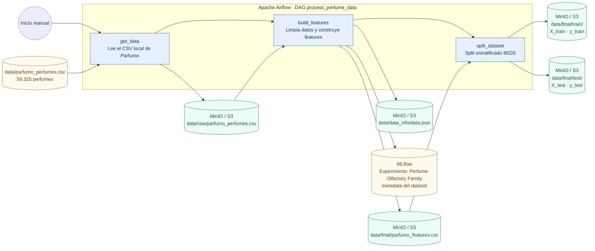
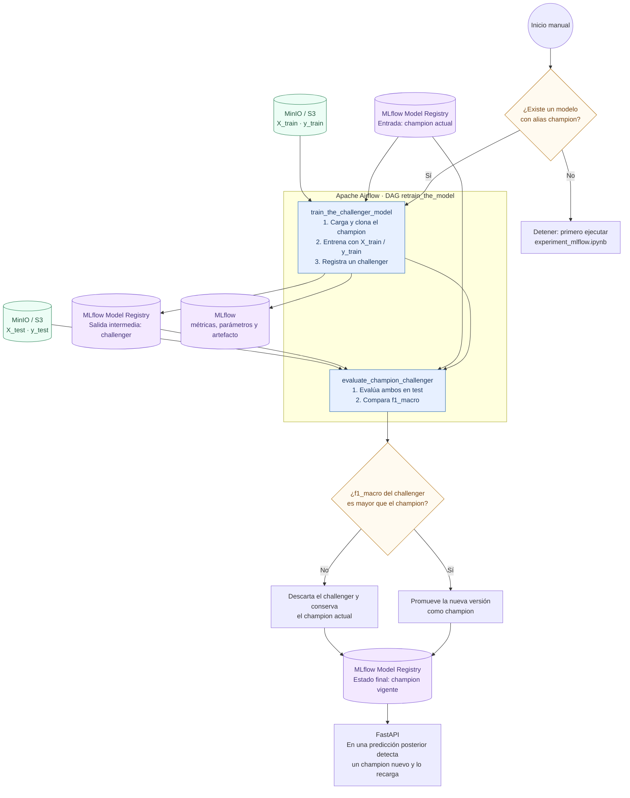

# Diagramas de los DAGs de Airflow

Estos diagramas describen las dependencias implementadas actualmente en `airflow/dags/`.
Están escritos en Mermaid, por lo que GitHub los renderiza directamente y también pueden
editarse o exportarse desde el editor de Mermaid.

## `process_perfume_data`: ETL y partición del dataset

`build_features` conserva perfumes con notas y accords completos, quita duplicados y
clases pequeñas, y crea 256 variables: indicadores de notas, variables numéricas y
categorías de concentración. `data.json` almacena los vocabularios y parámetros de
transformación que después necesita la API para construir las mismas columnas.

## `retrain_the_model`: challenger contra campeón

El DAG no hace búsqueda de hiperparámetros: reutiliza la arquitectura e hiperparámetros
del campeón actual, la reentrena sobre el split vigente y decide la promoción usando
`f1_macro`. La búsqueda inicial y el primer registro del campeón se hacen en
`notebook_example/experiment_mlflow.ipynb`.
